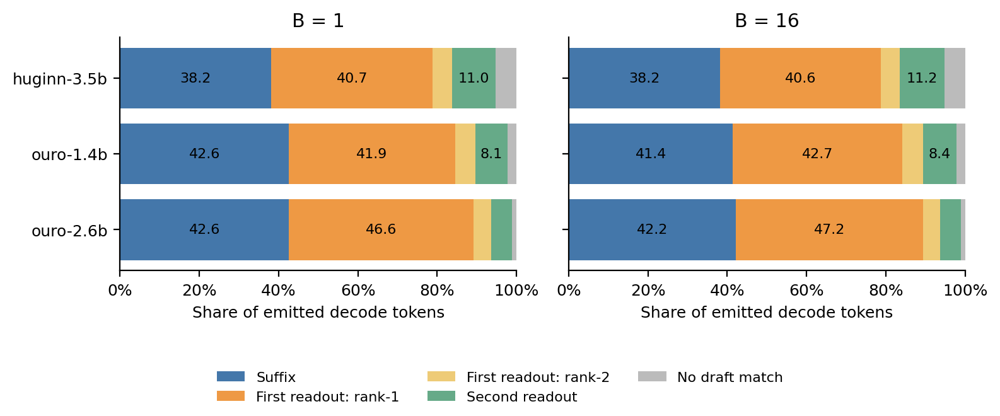
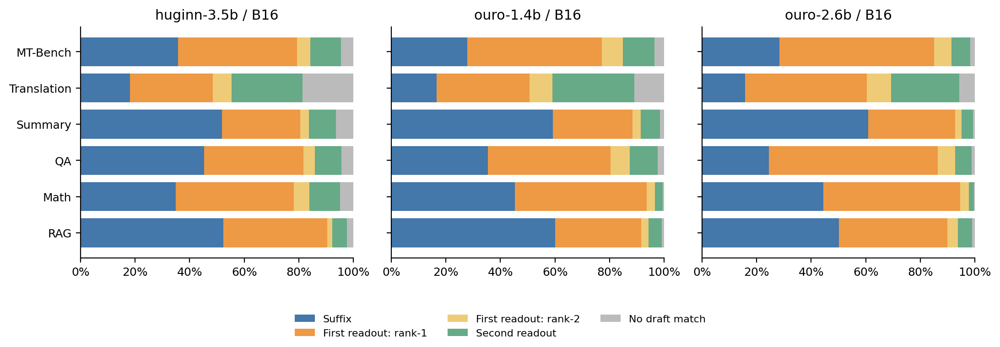

# LoopFill 最终接受 token 的来源构成

2026-11-09，已完成。按用户要求统计实际最终输出中的来源比例，直接复用正式表2日志，未启动新推理。三个模型 × B=1/2/4/8/16，共15组、7,200次请求，覆盖1,348,184个decode token；加上7,200个prefill首token，共1,355,384个输出token。每组SpecBench 480题、greedy、最多1024新token、LoopFill-online、N16、双次浅层读出top-2、BF16、Graph-off。

## 分母与来源定义

主比例为 `Σ某来源最终输出token数 / Σstats.tokens`，按token数汇总，排除每请求prefill直接产生的首token，包含原输出中保留的停止token。不是候选生成数占比，也不是各题百分比的平均。

| 类别 | 原计数 | 含义 |
|---|---|---|
| 后缀 | `from_suffix` | 最终命中的现存候选由suffix引入 |
| 首次读出第1候选 | `from_fill` | 第一次浅层读出的rank-1候选 |
| 首次读出第2候选 | `from_sibling` | 第一次浅层读出的rank-2候选；当前配置top-k=2 |
| 第二次读出 | `from_deep` | 第二次浅层读出新引入的候选，两种rank合计 |
| 未命中候选 | `tokens - covered_tokens` | 全深度输出时没有匹配草稿候选 |

浅层模型合计为fill+sibling+deep。Huginn两次读出是loop 4/8，Ouro是loop 1/2；`deep`不表示全深度验证。所有类别的输出均由全深度预测决定。

归属使用验证时现存候选的`origin`。同一候选被重复提出或重新打分，不重复计数、不改变来源；候选被淘汰后重新创建，则按最终存活候选的创建来源计数。因此不是整个请求中该token路径的最早提案来源，也不是来源独占或因果加速贡献。日志无法恢复双来源重合比例、suffix根查询与孩子续查的细分，或各来源候选在接受时已完成多少循环。

## 主结果

| 模型 | B | Decode tokens | 后缀 | 浅层模型合计 | 未命中候选 |
|---|---:|---:|---:|---:|---:|
| Huginn-3.5B | 1 | 54,523 | 38.16% | 56.61% | 5.23% |
| Huginn-3.5B | 16 | 55,241 | 38.19% | 56.56% | 5.25% |
| Ouro-1.4B | 1 | 117,018 | 42.59% | 55.17% | 2.23% |
| Ouro-1.4B | 16 | 113,735 | 41.41% | 56.35% | 2.25% |
| Ouro-2.6B | 1 | 99,531 | 42.62% | 56.31% | 1.08% |
| Ouro-2.6B | 16 | 97,435 | 42.23% | 56.67% | 1.10% |

显示值有四舍五入，原始整数严格守恒。

| 模型，B16 | 后缀 | 首次读出第1候选 | 首次读出第2候选 | 第二次读出 | 未命中候选 |
|---|---:|---:|---:|---:|---:|
| Huginn-3.5B | 38.19% | 40.56% | 4.81% | 11.19% | 5.25% |
| Ouro-1.4B | 41.41% | 42.67% | 5.26% | 8.41% | 2.25% |
| Ouro-2.6B | 42.23% | 47.17% | 4.37% | 5.13% | 1.10% |

各任务的来源构成有明显差异。例如Ouro-2.6B/B16，摘要的后缀来源占60.82%，翻译占15.77%。这些是当前运行中输出token的来源描述，不直接表示对应来源的加速贡献。

## 产物、审计与复现

- [总体CSV](../paper/figures/loopfill-token-sources/overall.csv)、[六任务CSV](../paper/figures/loopfill-token-sources/by-task.csv)已随论文图表入库；[完整报告](../results/loopfill-token-sources-20261109/report.md)与[逐请求CSV](../results/loopfill-token-sources-20261109/per-request.csv)也已按归档要求纳入Git。
- [总体PDF](../paper/figures/loopfill-token-sources/token-sources.pdf)、[分任务PDF](../paper/figures/loopfill-token-sources/token-sources-by-task.pdf)。
- [审计JSON](../paper/figures/loopfill-token-sources/audit.json)：15组均来自job指定的完成attempt，排除W&B副本；输入和冻结源码哈希核对通过；每组480个唯一请求，六任务各80题；输出总量与原summary一致。
- 逐请求验证四来源计数之和等于`covered_tokens`、五类之和等于`stats.tokens`、加prefill后等于真实输出长度。零decode请求保留，相关百分比为空。
- CSV另提供只以命中候选token为分母的`*_covered_pct`，以及含prefill全部输出为分母的`*_output_pct`和`prefill_output_pct`，避免混淆“所有输出”与“命中草稿的输出”。
- 复现及更新论文产物：`python scripts/loop_token_sources.py --paper-assets paper/figures/loopfill-token-sources`；针对分母、加权汇总、零decode及异常计数的6项测试通过。

长上下文、历史积累和高熵场景分析已按用户要求取消，见[当前实验范围](loopfill-paper-experiments.md)。
