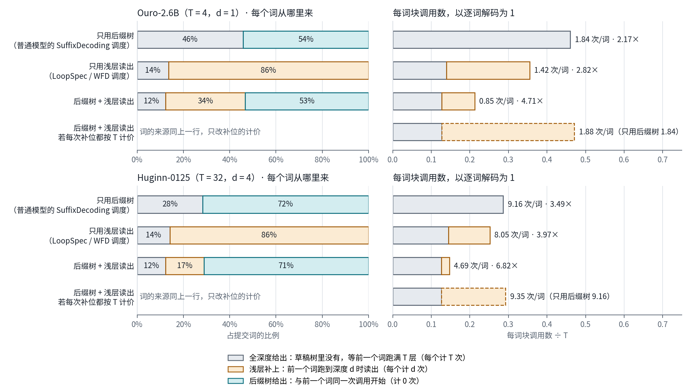
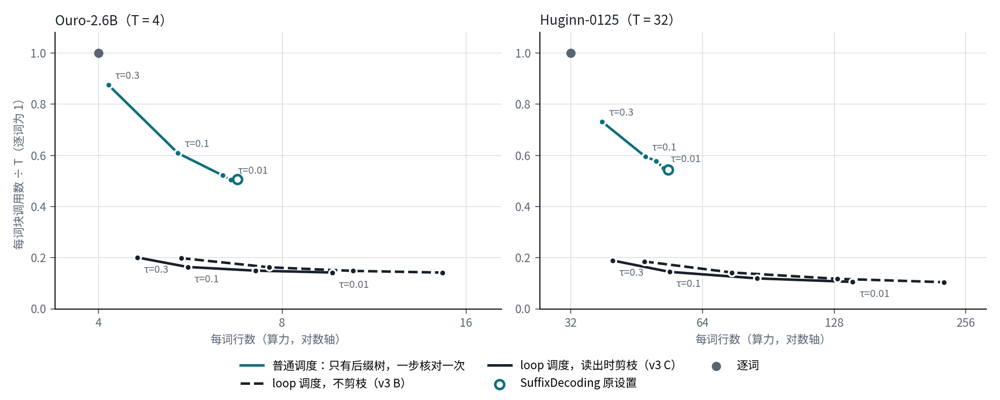
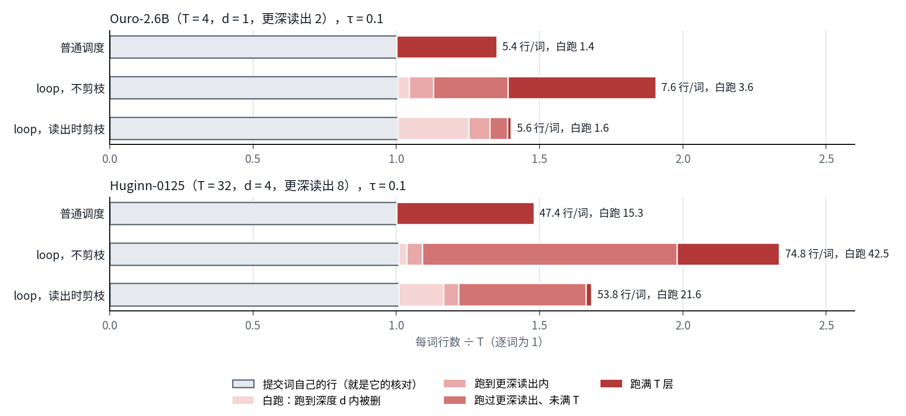
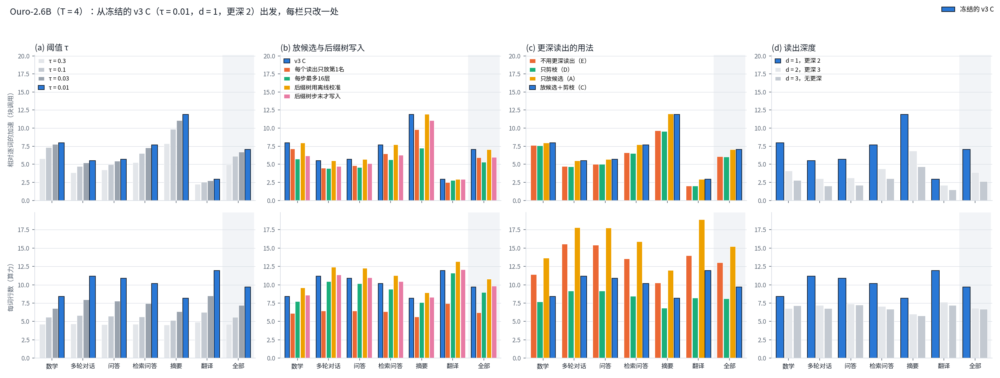
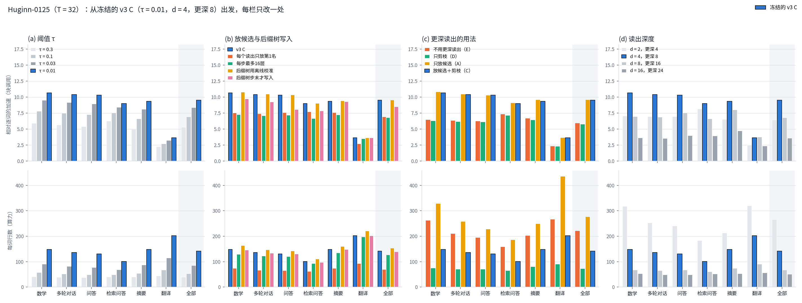

# Loop多词投机解码：后缀树与浅层读出共用一棵草稿树（结果，2026-10-31）

[协议](protocol.md)、[原理图](../../docs/design/loop-suffix-tree-spec-20261030.html)、[回放汇总JSON](sim/)。零训练。指标是贪心路径上每个输出词的**块调用次数**，表中倍数 = `T·词数/调用数`（相对逐词），属于离线上限，不是墙钟延迟。

## 结论（raw prompt，全量为主结果）

1. **后缀树让浅层多词草稿走得更远。** 预定主比较为主d、K=16、α=1、不剪枝，480题全量：
   - Ouro：只用浅层2.82倍，后缀树+浅层4.71倍（+67%）。
   - Huginn：只用浅层3.97倍，后缀树+浅层6.82倍（+72%）。
   - 合用也明显高于只用后缀树（Ouro 2.17倍、Huginn 3.49倍）。
   - 六个类别全部超过协议§7的5%门槛，最小的是Ouro MT-bench（+33%）。
2. **两种草稿互补。** 后缀树不占块调用，能成串给出重复片段；浅层补上后缀树猜不到的新词。在无循环敏感性子集上：
   - 只用后缀树只有1.55–1.60倍。
   - 合用仍比只用浅层多23–37%。
   - 被接受的草稿词中约45%来自后缀树。
3. **增益随输出重复程度上升。**
   - 按自重复率分组，Ouro从+29%（自重复<0.10）升到+168%（≥0.50），Huginn从+17%升到+98%。
   - base模型在raw prompt下循环较多：Huginn平均自重复0.58，只有88/480题低于0.25。
   - 循环是模型的真实输出，所以全量数字包含这部分。chat模板补跑（§9）检验格式改变后的结果。
4. **MT-bench第二轮（模型改写自己上一轮的回答）收益更高。** 同80题配对：
   - 合用从第一轮的3.66倍升到4.48倍（Ouro），5.42倍升到7.70倍（Huginn）。
   - 增加的部分来自复制上一轮回答：输出中出现在prompt里的4-gram占比，Ouro从0.05升到0.26，Huginn从0.04升到0.19；自重复几乎不变。
   - 这正是SuffixDecoding所说的self-refine场景，后缀树在loop模型上同样适用。
5. **代价是每次调用的并行行数。**
   - 每词行数（近似算力），合用比只用浅层多：Ouro 65%（7.1对4.3），Huginn 42%（49.9对35.1）。
   - 按浅层前4名剪枝能减10–17%的行数，倍数只降1–2%。
   - 能否兑现为墙钟加速，取决于宽树一次调用的实际耗时，本批没有测。
6. **loop给后缀树带来的是更便宜的补缺口（§10）。** 每个词按“比前一个词晚几次块调用开始计算”记账：后缀树给出的词晚0次，浅层补上的晚d次，草稿树里没有、等全深度输出的晚T次。合用臂中后缀树给出的词与只用后缀树几乎相同（少0.4–2.2%）。若把每次补位按T计价，调用数回到只用后缀树的水平（多0.5–2.4%）。所以合用相对普通模型SuffixDecoding的收益，全部来自后缀树的缺口由浅层在d次而不是T次内补上。同一后缀树、同一放候选规则下，loop调度在不多于普通调度的每词行数时，每词调用少2.5–3.7倍，读出时剪枝把多数错行删在浅处，所以这一优势在多请求时也成立（§10.2、§10.3）。

7. **消融：提速靠多放对的候选，算力靠剪枝与校准（§11）。** 从冻结的v3 C（τ=0.01）出发每次只改一处。只放第1名、加K=16上限、步末才写入后缀树、不用更深读出，加速分别降16%、25%、15%、13%（Ouro）和27%、28%、11%、37%（Huginn）。剪枝与解码器内校准几乎不改加速（不到1%），去掉它们每词行数多9–97%。冻结的补位深度（Ouro d=1，Huginn d=4）全部题目最快，更深的d行数更少，但同等行数下不如冻结的d提高τ。

## 1. 设置回顾

- **模型：** Ouro-2.6B（T=4，主d=1）与Huginn-0125（T=32，主d=4）。
- **数据：** Spec-Bench全部480题，6类各80题，MT-bench只取第一轮。
- **生成设置：** raw prompt（同WFD的约定，不套chat模板），截断512，贪心，最多256个新词。
- **四个臂：** 是同一过程的开关。
  - 逐词。
  - 只用浅层：深度d的第1候选补位，串成草稿。
  - 只用后缀树：原方法，在全深度核对。
  - 后缀树+浅层：后缀树草稿从第0次调用开始；浅层检查每个节点，补上缺的第1候选，后缀树再从补位词续写。
- **后缀树实现：** ArcticInference `aca5d9a`（单独编译的C++后缀树）。本题树含prompt与已提交输出；全局树按question_id顺序在线累积已完成的输出。
- **计数口径：** 调用数在贪心路径上精确计数。全深度teacher forcing与贪心输出的逐位一致率为0.9915（Ouro）、0.9916（Huginn），差异来自bf16的近似平局。

## 2. 主比较

| 设置 | 模型 | 题数 | 只用浅层 | 只用后缀树 | 后缀树+浅层 | 比只用浅层 | 每步词数（合） | 后缀树占比（合） | 每词行数 浅层→合 |
| --- | --- | ---: | ---: | ---: | ---: | ---: | ---: | ---: | --- |
| 第一轮 | Ouro | 480 | 2.82 | 2.17 | **4.71** | +67% | 7.87 | 0.61 | 4.3→7.1 |
| 第一轮 | Huginn | 480 | 3.97 | 3.49 | **6.82** | +72% | 7.94 | 0.81 | 35.1→49.9 |
| MT-bench第二轮 | Ouro | 80 | 2.81 | 2.05 | **4.48** | +59% | 7.52 | 0.58 | |
| MT-bench第二轮 | Huginn | 80 | 4.27 | 3.91 | **7.70** | +80% | 8.98 | 0.83 | |

**敏感性：无循环子集。** 筛选依据是自重复<0.25，即输出中有多少4-gram在本输出前文出现过。

| 设置 | 模型 | 覆盖 | 只用浅层 | 只用后缀树 | 后缀树+浅层 | 比只用浅层 | 后缀树占比（合） | 每词行数 浅层→合 |
| --- | --- | ---: | ---: | ---: | ---: | ---: | ---: | --- |
| 第一轮 | Ouro | 299/480 | 2.68 | 1.60 | 3.68 | +37% | 0.43 | 4.4→8.1 |
| 第一轮 | Huginn | 88/480 | 2.88 | 1.55 | 3.55 | +23% | 0.46 | 38.9→69.4 |
| MT-bench第二轮 | Ouro | 56/80 | 2.65 | 1.64 | 3.66 | +38% | 0.46 | |
| MT-bench第二轮 | Huginn | 28/80 | 3.34 | 2.22 | 4.64 | +39% | 0.67 | |

无循环子集的类别构成：Ouro为MT-bench 62、翻译65、摘要31、QA 29、数学67、RAG 45；Huginn为MT-bench 25、摘要27、数学17、QA 14、RAG 5、翻译0，不能代表全部类别。

## 3. 按类别（第一轮，主比较）

| 类别 | Ouro 平均输出长 / 自重复 | Ouro 浅层→合 | Huginn 平均输出长 / 自重复 | Huginn 浅层→合 |
| --- | --- | --- | --- | --- |
| MT-bench | 226 / 0.18 | 2.75→3.66（+33%） | 233 / 0.50 | 3.66→5.42（+48%） |
| 翻译 | 79 / 0.13 | 2.06→3.43（+67%） | 256 / 0.79 | 4.52→9.25（+105%） |
| 摘要 | 224 / 0.49 | 2.89→6.01（+108%） | 176 / 0.46 | 4.01→7.39（+84%） |
| QA | 237 / 0.47 | 2.88→4.99（+73%） | 245 / 0.60 | 3.84→5.93（+54%） |
| 数学推理 | 225 / 0.18 | 3.14→5.05（+61%） | 229 / 0.60 | 4.02→7.39（+84%） |
| RAG | 197 / 0.33 | 2.84→5.14（+81%） | 256 / 0.56 | 3.87→6.77（+75%） |

- Ouro增益最大的是摘要和RAG，这两类prompt里有大段可复制的原文。
- Ouro翻译输出短（平均79词），66/80题正常停止，增益仍有+67%。
- Huginn翻译80题全部写满256词并陷入循环，9.25倍主要来自循环。

## 4. 按自重复率分组（第一轮，只用浅层→合）

| 自重复 | Ouro 题数 | Ouro | Huginn 题数 | Huginn |
| --- | ---: | --- | ---: | --- |
| <0.10 | 182 | 2.51→3.25（+29%） | 42 | 2.82→3.31（+17%） |
| 0.10–0.25 | 117 | 2.88→4.23（+47%） | 46 | 2.91→3.67（+26%） |
| 0.25–0.50 | 53 | 2.88→4.83（+68%） | 75 | 3.44→5.14（+49%） |
| ≥0.50 | 128 | 3.02→8.08（+168%） | 317 | 4.38→8.69（+98%） |

- 只用浅层随重复程度变化不大（Ouro 2.5–3.0倍）。
- 合用的倍数随重复程度单调上升。
- 这说明后缀树的贡献集中在重复片段：既有本输出内的重复，也有从prompt复制的部分（见§5）。

## 5. MT-bench第二轮与第一轮配对（同80题）

MT-bench在question_id顺序中排最前，所以第一轮这80题回放时，全局树里也只有先前MT-bench题的输出，与第二轮的全局树结构相同。

| 模型 | 轮 | 只用浅层 | 只用后缀树 | 后缀树+浅层 | 后缀树占比 | 自重复 | 复制prompt | 平均输出长 | 正常停止 |
| --- | --- | ---: | ---: | ---: | ---: | ---: | ---: | ---: | ---: |
| Ouro | 1 | 2.75 | 1.53 | 3.66 | 0.39 | 0.18 | 0.05 | 226 | 16/80 |
| Ouro | 2 | 2.81 | 2.05 | 4.48 | 0.58 | 0.22 | 0.26 | 244 | 8/80 |
| Huginn | 1 | 3.66 | 2.42 | 5.42 | 0.69 | 0.50 | 0.04 | 233 | 12/80 |
| Huginn | 2 | 4.27 | 3.91 | 7.70 | 0.83 | 0.50 | 0.19 | 220 | 15/80 |

- 只用浅层在两轮之间几乎不变。
- 后缀树的两个臂都上升，与“复制prompt”占比同步。
- 第二轮的prompt是“第一轮prompt+本模型第一轮输出+第二轮问题”，没有套模板，见协议§7a。

## 6. 探索网格（第一轮全量，非预定）

| Ouro | K=4 | 8 | 16 | 32 |
| --- | ---: | ---: | ---: | ---: |
| 只用浅层 d1 | 2.26 | 2.60 | 2.82 | 2.93 |
| 只用浅层 d2 | 1.63 | 1.76 | 1.83 | 1.87 |
| 只用后缀树 α1 / α2 | 1.97 / 2.07 | 2.10 / 2.23 | 2.17 / 2.32 | 2.20 / 2.36 |
| 合 d1 α1 / α2 | 3.13 / 3.19 | 4.01 / 4.13 | 4.71 / 4.91 | 5.10 / 5.35 |
| 合 d2 α1 / α2 | 2.64 / 2.70 | 3.18 / 3.31 | 3.58 / 3.78 | 3.79 / 4.03 |

| Huginn | K=4 | 8 | 16 | 32 |
| --- | ---: | ---: | ---: | ---: |
| 只用浅层 d2 / d4 / d8 | 2.68 / 2.84 / 2.39 | 3.15 / 3.49 / 2.81 | 3.43 / 3.97 / 3.13 | 3.54 / 4.25 / 3.31 |
| 只用后缀树 α1 / α2 | 2.68 / 2.74 | 3.16 / 3.31 | 3.49 / 3.72 | 3.67 / 3.94 |
| 合 d2 α1 | 3.53 | 4.69 | 5.70 | 6.35 |
| 合 d4 α1 | 3.79 | 5.33 | 6.82 | 7.84 |
| 合 d8 α1 / α2 | 3.81 / 3.84 | 5.44 / 5.56 | 7.18 / 7.45 | 8.36 / 8.78 |

- **K越大越好。** 合用比单独两臂更依赖K：后缀树能一次送出长串。
- **合用后浅层最优深度变深。** 只用浅层时Huginn最优d=4（d=8为3.13倍）；合用时d=8最好，无循环子集3.92对3.55倍。后缀树负责便宜的长草稿，浅层只需在缺口处补准确的词，所以可以读得更深。
- **α=2** 多1–5%，K越大差得越多。
- **剪枝m=4：** Ouro 4.71→4.62倍、行数7.1→5.9；Huginn 6.82→6.73倍、行数49.9→44.7。

## 7. 运行记录

- **正常停止**（遇EOS）。Ouro 186/480，其中翻译66，RAG 41；Huginn 63/480，其中翻译、RAG为0。其余写满256词。
- **一次失败：** Huginn worker `huginn-w16` 于00:14在共享的GPU 7上CUDA OOM，第481题（RAG）的claim改名保留。该题随后单独重跑，设置相同，见[RUNNING](RUNNING.txt)。
- **运行规模：** 第一轮各480题，第二轮各80题，无缺失。

## 8. 解读的适用范围

- **只到离线上限。** 倍数是串行块调用的比，假设一次块调用的耗时不随树宽（行数）增加；后缀树查找的CPU时间、kernel开销都不计入。墙钟实测见[墙钟批次](../loop-suffix-spec-wallclock-20261031/protocol.md)（2026-10-31代码就绪，未运行）。
- **与LoopSpec的口径相同。** 倍数与[LoopSpec](https://arxiv.org/abs/2609.17184)的平均接受长度γ（Eq. 9）是同一个量：R×词数/串行循环步数，不含prelude/coda。
  - 记账相同：补位每d次调用一个、不等核对，即LoopSpec的流水线；被拒时纠正词等满T次。所以“只用浅层”约等于LoopSpec的单提案d₁。
  - 两处差别：本批每步草稿有K个词的上限，到上限强制结束一步，使只用浅层略偏低（Ouro K=16为2.82，K=32为2.93）；LoopSpec另有更深的第二提案d₂。
  - LoopSpec同时报墙钟：Ouro-2.6B在d₁=1时，GSM8K墙钟3.03×、γ 3.43，墙钟约为γ的85–90%。本批只对应其γ列。
  - 更正：本节旧稿与协议§7写“非流水线调度对只用浅层的对照偏保守”，不准确，步内记账本来就是流水线式，差别只在K上限。
- **全局树的累积方式。** 全局树按question_id顺序跨类别累积；同类别题目之间的模板化输出（如Huginn翻译循环）可能被全局树互相引用。
- **两个模型都是base模型，用raw prompt。** 循环和不停止较多，下面的chat补跑检验这一点。
- **RAG的问题被截掉了。** 沿用WFD的约定，prompt从末尾截到512 token。
  - RAG的问题在检索段落之后，80题prompt全部超长，问题都被截掉，模型实际是在续写段落；chat补跑同样如此，Huginn 78/80。
  - 摘要有57–60题超长，但“Summarize:”在开头，被截掉的只是文章后半，任务不变。
  - 草稿接受的计数仍然有效，因为输出是模型的真实文本；但RAG一类的含义是“续写检索段落”，不是“基于检索回答”。

## 9. chat模板补跑（协议§7b，运行中）

2026-10-31 00:03在GPU 5、8启动：用模型自带的chat模板，并在回合结束符处停止。

- 首批输出中，Huginn正常以`<|end_turn|>`结束。
- Ouro在自己的模板下常以`<think>`开头，先写推理，长题会用满256词。这是该模型在其模板下的自然行为，未改设置。

完成后在此补充同口径结果，以及与raw的对照。

## 10. loop调度给后缀树带来什么（10-31追加）

设计见[协议§10](protocol.md#10-追加loop调度给后缀树带来什么用户2026-10-31要求只用cpu回放)。后缀树与模型无关，普通Transformer上就是SuffixDecoding。loop带来的不是更好的草稿，而是更便宜的补缺口：后缀树漏掉一个词，普通模型要等下一次完整核对（T次块调用），loop在前一个词跑到深度d时就由浅层读出补上（d次）。

### 10.1 每个词从哪里来、花多少块调用（比较1，已有回放）

一个词能提交，要等它前一个词跑满T层、给出全深度输出。按“这个词比前一个词晚几次块调用开始计算”，每个提交的词分三类：

| 来源 | 什么时候开始计算 | 比前一个词晚 |
| --- | --- | ---: |
| 后缀树给出 | 与前一个词在同一次调用开始（后缀树一次给出一串，同批开始） | 0次 |
| 浅层补上 | 后缀树漏掉，前一个词跑到深度d时由浅层读出补上 | d次 |
| 全深度给出 | 草稿树里没有，等前一个词跑满T层，从全深度输出得到，这一步在此结束 | T次 |

总块调用数就是这些“晚开始的次数”之和：

> 总块调用数 = T ×（全深度给出的次数）+ d ×（浅层补上的词数）

回放中这个等式的误差小于0.5%，来自每题最后一步（输出在那里结束，不再给出新词）。普通模型上的SuffixDecoding没有第二类：后缀树漏掉的词都要等满T次。

图中左列是三类词的比例，右列是每词块调用数（以逐词解码为1）。最后一行是反事实：词的来源与合用臂相同，但每次补位都按T计价。

raw-256，480题（主比较）：

| 模型 | 调度 | 全深度给出 | 浅层补上 | 后缀树给出 | 每词调用 | 倍数 | 每词行数 |
| --- | --- | ---: | ---: | ---: | ---: | ---: | ---: |
| Ouro | 只用后缀树（普通模型的SuffixDecoding调度） | 46% | 0 | 54% | 1.84 | 2.17 | 6.5 |
| | 只用浅层（LoopSpec/WFD调度） | 14% | 86% | 0 | 1.42 | 2.82 | 4.3 |
| | 后缀树+浅层 | 12% | 34% | 53% | 0.85 | 4.71 | 7.1 |
| Huginn | 只用后缀树 | 28% | 0 | 72% | 9.16 | 3.49 | 43.6 |
| | 只用浅层 | 14% | 86% | 0 | 8.05 | 3.97 | 35.1 |
| | 后缀树+浅层 | 12% | 17% | 71% | 4.69 | 6.82 | 49.9 |

两点：

1. **后缀树给出的词几乎不变。** 合用臂中后缀树给出的词比只用后缀树少0.4–2.2%（三种设置、全量与无循环子集都在这个范围）。后缀树本身的贡献没有因为合用而变大。
2. **补位若按T计价，合用就退回只用后缀树。** 反事实调用数只比只用后缀树多0.5–2.4%（Ouro raw 1.88对1.84次/词，Huginn 9.35对9.16）。所以合用相对普通模型SuffixDecoding的全部收益，就是每个补位省下的T−d次调用。全深度给出的词从46%降到12%（Ouro），从28%降到12%（Huginn）。

其他设置（同口径，倍数为只用后缀树 → 只用浅层 → 合用）：

| 设置 | 模型 | 全深度给出：只用后缀树 → 合用 | 倍数 | 反事实相对只用后缀树 |
| --- | --- | --- | --- | ---: |
| raw-256 无循环子集 | Ouro | 63% → 15% | 1.60 → 2.68 → 3.68 | +1.9% |
| | Huginn | 64% → 23% | 1.55 → 2.88 → 3.55 | +0.5% |
| chat模板 | Ouro | 54% → 13% | 1.85 → 2.80 → 4.19 | +1.8% |
| | Huginn | 59% → 21% | 1.68 → 2.93 → 3.72 | +1.9% |
| sb1024 chat | Ouro | 50% → 13% | 1.98 → 2.83 → 4.43 | +1.7% |
| | Huginn（477题） | 54% → 19% | 1.84 → 3.14 → 4.12 | +1.8% |

**为什么只有loop能这样。** 共享块每一层的权重相同，补上的新词可以在同一次块调用里从深度0开始，与已经跑到深度3的词共用一次矩阵乘。普通Transformer各层权重不同，新词只能等下一次前向。早退方法能给出中途读出，但不能把新词插进正在进行的前向。浅层读出又是同一模型的免训练草稿，补位的猜对率约78–81%（[prob-tree §2](../loop-spec-prob-tree-20261031/report.md#2-p在解码器里是否校准)）。

**反方向：后缀树给loop的。** 只用浅层时每d次调用最多出一个词，倍数不超过T/d。后缀树给出的词不占调用，所以合用能超过这个上限：Ouro raw 4.71倍高于T/d=4，Huginn在d=8、K=32时达到8.36–8.78倍（§6探索网格），高于T/d=4。这主要发生在重复多的输出上，Ouro无循环子集合用3.68倍，仍低于4。

**算力。** 合用的每词行数比只用后缀树多9%（Ouro）和14%（Huginn），调用数减半。回放只沿真实路径补位，引擎实测更费：both-path每词行数13.8对只用后缀树7.2（Ouro），142对50（Huginn），见10.2。

汇总：[`sim/ledger.json`](sim/ledger.json)，由[`loop_suffix_spec_ledger.py`](../../scripts/loop_suffix_spec_ledger.py)从本批回放汇总生成。

### 10.2 同一后缀树，两种调度：调用数与算力（比较2）

两种调度用同一棵后缀树、同一放候选规则（猜对概率超过τ就放，后缀树边用prob-tree批次的in-situ校准表），只改调度：

- **普通调度：** 只有后缀树起草，草稿在一步开始时入场，经过T次调用核对一次后结束这一步。这就是非loop模型上的SuffixDecoding，按块调用计。
- **loop调度：** prob-tree批次的v3 B（深度d与更深一层联合打分）和v3 C（B加读出时剪枝）。

纵轴是每词块调用数（以逐词为1，决定单请求延迟），横轴是每词行数（算力，多请求时决定吞吐）。逐词解码在右上角之外的(T, 1)处，即图中灰点。

| 设置 | 模型 | 普通调度最好点（τ=0.001） | SuffixDecoding原设置 | loop v3 C τ=0.3 | loop v3 C τ=0.1 | 不多用算力时，loop调用少 |
| --- | --- | --- | --- | --- | --- | ---: |
| sb1024 chat | Ouro | 2.01次，6.7行 | 2.02次，6.8行 | 0.80次，4.6行 | 0.655次，5.6行 | 3.1倍（τ=0.1） |
| | Huginn（477题） | 17.3次，53.3行 | 17.4次，53.4行 | 6.05次，39.9行 | 4.63次，53.8行 | 3.7倍（τ=0.1） |
| raw-256 | Ouro | 1.82次，6.6行 | 1.84次，6.5行 | 0.78次，4.7行 | 0.64次，5.6行 | 2.8倍（τ=0.1） |
| | Huginn | 8.71次，45.0行 | 9.16次，43.6行 | 3.42次，39.0行 | 2.65次，47.8行 | 2.5倍（τ=0.3） |

每格是每词块调用数和每词行数。逐词解码为T次、T行（Ouro 4，Huginn 32）。

1. **loop调度的曲线整体在普通调度下方。** 在不多于普通调度最好点的行数下，loop调度的每词调用数少2.5–3.7倍。所以loop给后缀树的优势在多请求时仍然成立，不是靠多花算力换来的。
2. **loop调度可以同时省调用和算力。** τ=0.3时，每词行数只比逐词多16–18%（Ouro）和22–25%（Huginn），每词调用数是逐词的0.11–0.20。普通调度在相近的行数（τ=0.3）时，每词调用数还是逐词的0.59–0.88。
3. **普通调度降低阈值几乎没有收益。** τ从0.01降到0.001，调用数只少0.5–1.7%，行数多0.8–2.3%。SuffixDecoding原设置（`min_token_prob=0.1`，K=16）比最好点多0.8–1.3%的调用，只有raw-256的Huginn多5%，来自K=16上限。
4. **读出另计。** loop调度每词还要做3.5次（Ouro）和5.2次（Huginn）读出（v3 C，τ=0.1，sb1024 chat），每次是一次LM head，Huginn还要过coda。普通调度没有读出。行数没有包含这部分。

loop调度的行数是近似值（错枝下的读出用路径同位置代替，同prob-tree协议），普通调度没有读出，行数精确。raw-256的曲线见[frontier-full.png](schedule/frontier-full.png)，结论相同。

### 10.3 白跑的算力（比较3）

提交的词自己跑过的层就是它的核对，不算浪费。白跑的是不在提交路径上的行。下图按“被删之前跑了几层”拆开白跑的行（τ=0.1）：

| 模型 | 设置 | 每词行数 | 白跑行/词 | 白跑行中，深度d内被删 | 白跑行中，跑满T层 | 每词调用 |
| --- | --- | ---: | ---: | ---: | ---: | ---: |
| Ouro | 普通调度 | 5.4 | 1.4 | 0 | 100% | 2.43 |
| | loop，不剪枝（v3 B） | 7.6 | 3.6 | 5% | 57% | 0.650 |
| | loop，读出时剪枝（v3 C） | 5.6 | 1.6 | 63% | 3% | 0.655 |
| Huginn | 普通调度 | 47.4 | 15.3 | 0 | 100% | 19.0 |
| | loop，不剪枝（v3 B） | 74.8 | 42.5 | 2% | 27% | 4.54 |
| | loop，读出时剪枝（v3 C） | 53.8 | 21.6 | 23% | 3% | 4.63 |

1. **普通调度中，错草稿全部跑满T层才被删。** 这就是普通模型里一个错草稿词要跑完整个前向的代价。
2. **loop不剪枝时白跑更多。** 兄弟候选、补位和更深读出的候选也会错，Ouro白跑3.6行/词，是普通调度的2.6倍。
3. **读出时剪枝把错行在浅处删掉。** Ouro 63%的白跑行在深度d内被删，每词行数从7.6降到5.6（−26%），调用只多0.8%。Huginn行数从74.8降到53.8（−28%），调用多1.8%。后缀树的白跑从2.5降到0.8行/词（Ouro），从19.5降到5.7（Huginn）。
4. **Huginn剩下的白跑主要是错的补位（9.2行/词）。** 补位在深度4放入，猜对概率高于阈值就不会被剪掉，猜错时要跑到父节点核对，最多28层（图中“跑过更深读出、未满T”）。这部分要靠更好的补位概率，不能靠剪枝。

raw-256见[waste-full.png](schedule/waste-full.png)，结论相同。

### 10.4 小结

- 后缀树本身与模型无关。loop给它的是：缺口在d次而不是T次调用内补上（比较1），以及错草稿可以在浅处删掉（比较3）。
- 这两点在同样算力下都成立（比较2）：算力不多于普通调度时，每词调用少2.5–3.7倍。
- 以上都是回放的块调用与行数。墙钟、多请求下的实测吞吐还没有测，见prob-tree批次的S3、S4。

汇总：[`schedule/`](schedule/)（`summary-<设置>-<模型>.json`，由[`loop_suffix_schedule_compare.py`](../../scripts/loop_suffix_schedule_compare.py)回放、[`loop_suffix_schedule_report.py`](../../scripts/loop_suffix_schedule_report.py)整理）。插桩回放与`ProbReplay.run`在前20题上逐题一致，v3 B/C在选择集上与prob-tree批次`v3`扫描的调用数、行数完全相同。回放于10-31 22:54–22:59 UTC在NUMA 0的核0–3上运行，与prob-tree批次的墙钟测速（NUMA 1）时段重叠，用户确认后执行。

## 11. 冻结设计v3 C的消融（11-01追加）

设计见[协议§11](protocol.md#11-追加冻结设计v3-c的消融用户2026-11-01要求参照expweaver图4只用cpu回放)。参照ExpWeaver图4：从prob-tree批次冻结的v3 C（τ=0.01，Ouro d=1、更深一层2，Huginn d=4、更深一层8）出发，每栏只改一处，其余固定。横轴是Spec-Bench六类与全部。上排是相对逐词的加速（T×词数÷块调用数），下排是每词行数。数据为sb1024 chat全部480题（Huginn 477题），τ、变体C与d都在其中420题上选定。(a)、(c)取prob-tree批次的v3扫描，(b)、(d)本次补跑。

每格为“加速 · 每词行数”，全部题目。确认集为墙钟用过的60题（每类10题），只报加速。

| 改动 | Ouro τ=0.01 | Ouro τ=0.1 | Ouro 确认集 τ=0.01 | Huginn τ=0.01 | Huginn τ=0.1 | Huginn 确认集 τ=0.01 |
| --- | ---: | ---: | ---: | ---: | ---: | ---: |
| 现行解码器（第1名总补位，K=16） | 4.43× · 22.4 | — | 3.91× | 4.12× · 1104.0 | — | 4.51× |
| v3 C（冻结） | 7.04× · 9.7 | 6.11× · 5.6 | 6.02× | 9.50× · 141.2 | 6.92× · 53.8 | 10.29× |
| (b) 每个读出只放第1名 | 5.93× · 6.2 | 5.68× · 5.3 | 5.05× | 6.93× · 70.3 | 6.29× · 48.1 | 7.56× |
| (b) 每步最多16层 | 5.29× · 9.0 | 4.78× · 5.4 | 4.73× | 6.81× · 127.2 | 5.60× · 52.0 | 7.11× |
| (b) 后缀树用离线校准 | 7.06× · 10.8 | 6.20× · 6.4 | 6.04× | 9.56× · 153.6 | 7.04× · 59.4 | 10.34× |
| (b) 后缀树步末才写入 | 6.01× · 9.8 | 5.61× · 5.7 | 5.65× | 8.50× · 139.2 | 6.72× · 53.8 | 9.11× |
| (c) 不用更深读出（E） | 6.09× · 13.0 | 5.09× · 6.1 | 5.15× | 5.96× · 222.5 | 4.32× · 63.8 | 6.53× |
| (c) 只剪枝（D） | 6.02× · 8.1 | 5.00× · 5.3 | 5.09× | 5.79× · 73.7 | 4.22× · 42.6 | 6.33× |
| (c) 只放候选（A） | 7.05× · 15.2 | 6.16× · 7.7 | 6.02× | 9.59× · 277.8 | 7.06× · 77.5 | 10.44× |
| (d) Ouro d=1，更深2 | 7.04× · 9.7 | 6.11× · 5.6 | 6.02× |  |  |  |
| (d) Ouro d=2，更深3 | 3.90× · 6.8 | 3.74× · 5.6 | 3.36× |  |  |  |
| (d) Ouro d=3，无更深 | 2.66× · 6.7 | 2.61× · 6.0 | 2.28× |  |  |  |
| (d) Huginn d=2，更深4 |  |  |  | 6.45× · 266.4 | 4.45× · 66.7 | 7.02× |
| (d) Huginn d=4，更深8 |  |  |  | 9.50× · 141.2 | 6.92× · 53.8 | 10.29× |
| (d) Huginn d=8，更深16 |  |  |  | 6.79× · 67.7 | 6.03× · 42.9 | 7.23× |
| (d) Huginn d=16，更深24 |  |  |  | 3.61× · 50.9 | 3.51× · 42.7 | 3.82× |

**核对。** 主d下重算的离线表与解码器内表与冻结的calib-v3逐项相同。C τ=0.01重跑与v3扫描的调用数、行数相同（Ouro 7.04倍、9.7行，Huginn 9.50倍、141.2行）。

### 11.1 结论

1. **部件分两类：提速的和省算力的。**
   - 提速的部件：兄弟候选、去掉K上限、接受即写入后缀树、更深读出放入新候选、浅的补位深度。τ=0.01时去掉任何一项，加速都下降：Ouro降13–45%，Huginn降11–37%。
   - 省算力的部件：读出时剪枝和解码器内校准。τ=0.01时去掉剪枝（A），加速变化不到1%，每词行数多57%（Ouro）和97%（Huginn）。换回离线校准表，加速变化不到1%，行数多11%和9%。
2. **兄弟候选：要省算力应提高τ，不应只放第1名。** 只放第1名时行数少36%和50%，加速降16%和27%。同等算力下它不如提高τ：Ouro只放第1名（τ=0.01）为5.93倍、6.2行，C在τ=0.1为6.11倍、5.6行。Huginn为6.93倍、70.3行，对C在τ=0.1的6.92倍、53.8行。
3. **K上限的代价集中在重复多的输出上。** 加K=16上限使加速降25%（Ouro）和28%（Huginn），行数只少7%和10%。翻译几乎不受影响（−5%和−4%），Ouro摘要降39%，Huginn数学、对话、问答降30–32%。
4. **后缀树要每接受一个词就写入。** 改为步末写入，加速降15%（Ouro）和11%（Huginn），行数变化不到4%。降幅因类别而异：摘要、翻译几乎不变（0–7%），Ouro数学降23%，Huginn问答降22%。Ouro确认集只降6%。
5. **更深读出的收益来自放入新候选。** 不用更深读出（E）加速降13%和37%。只剪枝（D）的加速与E相近，行数最少，但同等行数下不如提高τ的C（prob-tree报告§5）。
6. **读出深度：冻结的d最快。**
   - Ouro d=1在六类、两个τ上都最快，d=2、3在τ=0.01时加速降45%和62%。
   - Huginn d=4全部题目最快（τ=0.01：d=2、4、8、16为6.45、9.50、6.79、3.61倍）。d=8只在翻译（τ=0.01）以及摘要、翻译（τ=0.1）上略快。
   - d越深每词行数越少，但同等算力下不如冻结的d提高τ：d=8在τ=0.01时6.79倍、67.7行，被d=4在τ=0.1时的6.92倍、53.8行支配。d=8在τ=0.1时（6.03倍、42.9行）落在d=4的τ=0.1与τ=0.3（5.29倍、39.9行）之间，是重负载下可选的点。
   - 按协议§11事先写定的规则，没有一个d在两个τ上都优于冻结的d，冻结配置不变。
   - 旧规则（只补第1名、K=16）下合用时Huginn d=8好于d=4（§6），v3 C下反过来。一个可能的解释是兄弟候选和更深一层读出弥补了浅层第1名不准，更早、更便宜的补位变得更划算。这一点没有单独检验。
7. **确认集上方向相同。** 每一处改动在确认集上的加速变化与全部题目同号。离线校准在两个集上都快0.3–2.0%，同时行数多。

### 11.2 适用范围

调用数在贪心路径上精确。行数是近似值（同§10），读出次数（LM head）没有计入，而读出次数随d和是否用更深读出变化。图中只画τ=0.01，τ=0.1见表。墙钟只测了冻结设计的两个工作点（prob-tree批次S4），消融中的各改动没有测墙钟。

汇总：[`ablation/`](ablation/)（`summary-sb-chat-<模型>.json`，由[`loop_prob_tree_ablation.py`](../../scripts/loop_prob_tree_ablation.py)生成）。回放于11-01 01:04–01:09 UTC在NUMA 0的核0–7上运行，与prob-tree批次NUMA 1上最后一个测速分片（s0）时段重叠，用户要求并行后执行。
