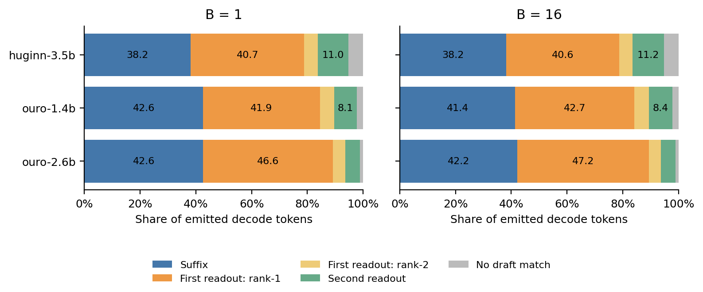
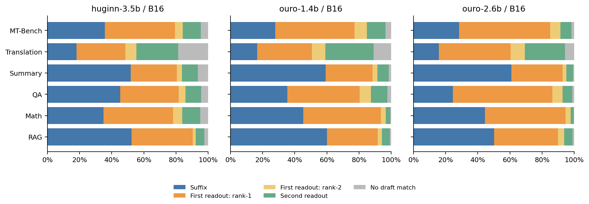

# LoopFill 最终输出 token 的来源比例

2026-11-09。复用表2 LoopFill-online：三模型 × B=1/2/4/8/16，共15组、7,200次请求。每组完整SpecBench 480题、greedy、最多1024新token、N16、双读出top-2、BF16、Graph-off；未启动新推理。

## 统计定义

主分母为所有最终输出的decode token，即Σstats.tokens；排除每请求prefill直接产生的首token，包含原始输出中保留的停止token。按token数加权汇总，不平均各请求百分比。

| 类别 | 原字段 | 含义 |
|---|---|---|
| 后缀 | from_suffix | 验证命中由suffix首先引入的现存候选 |
| 首次读出第1候选 | from_fill | 首次浅层读出的第一候选 |
| 首次读出第2候选 | from_sibling | 首次浅层读出的第二候选；本协议top-k=2 |
| 第二次读出 | from_deep | 第二次浅层读出新引入的候选，含其top-1和top-2 |
| 未命中候选 | tokens − covered_tokens | 全深度输出时不存在匹配草稿候选 |

Huginn两次读出为loop 4/8，Ouro为loop 1/2。deep仍是浅层提案，不是全深度输出。浅层模型合计=fill+sibling+deep。所有类别的实际输出均由全深度预测决定。

同一现存候选被多个来源重复提出时，保留其origin，不因后来的重新打分改变归属。候选被淘汰后重新创建，按最终存活候选的创建来源计数；不是该token路径在整个请求中的最早来源。该规则受实际提案次序影响，不能解释成来源独占贡献或因果加速比例。现有日志无法另外恢复“两源都提出”、suffix根查询/孩子续查、或接受时已经完成计算的来源交叉比例。

CSV同时提供 *_decode_pct、*_covered_pct 和 *_output_pct：分别以全部decode输出、命中草稿的输出、含prefill的全部输出为分母。含prefill口径另有prefill_output_pct，六类合计100%。零分母记空值。每请求核验四种来源计数之和等于covered_tokens，五类之和等于tokens，再加prefill等于实际输出长度。

## 主结果：B1与B16

| 模型 | B | Decode tokens | 后缀 | 浅层模型合计 | 未命中候选 |
|---|---:|---:|---:|---:|---:|
| huginn-3.5b | 1 | 54,523 | 38.16% | 56.61% | 5.23% |
| huginn-3.5b | 16 | 55,241 | 38.19% | 56.56% | 5.25% |
| ouro-1.4b | 1 | 117,018 | 42.59% | 55.17% | 2.23% |
| ouro-1.4b | 16 | 113,735 | 41.41% | 56.35% | 2.25% |
| ouro-2.6b | 1 | 99,531 | 42.62% | 56.31% | 1.08% |
| ouro-2.6b | 16 | 97,435 | 42.23% | 56.67% | 1.10% |

## 五类来源明细

| 模型 | B | Decode tokens | 后缀 | 首次读出第1候选 | 首次读出第2候选 | 第二次读出 | 未命中候选 |
|---|---:|---:|---:|---:|---:|---:|---:|
| huginn-3.5b | 1 | 54,523 | 38.16% | 40.74% | 4.84% | 11.02% | 5.23% |
| huginn-3.5b | 2 | 54,581 | 37.73% | 40.87% | 4.71% | 11.39% | 5.30% |
| huginn-3.5b | 4 | 54,372 | 37.73% | 40.77% | 4.89% | 11.48% | 5.13% |
| huginn-3.5b | 8 | 54,353 | 38.02% | 40.66% | 4.94% | 11.19% | 5.19% |
| huginn-3.5b | 16 | 55,241 | 38.19% | 40.56% | 4.81% | 11.19% | 5.25% |
| ouro-1.4b | 1 | 117,018 | 42.59% | 41.93% | 5.11% | 8.13% | 2.23% |
| ouro-1.4b | 2 | 117,116 | 42.38% | 41.81% | 5.16% | 8.42% | 2.23% |
| ouro-1.4b | 4 | 117,413 | 42.29% | 41.91% | 5.17% | 8.34% | 2.29% |
| ouro-1.4b | 8 | 114,641 | 41.58% | 42.48% | 5.28% | 8.43% | 2.23% |
| ouro-1.4b | 16 | 113,735 | 41.41% | 42.67% | 5.26% | 8.41% | 2.25% |
| ouro-2.6b | 1 | 99,531 | 42.62% | 46.58% | 4.49% | 5.24% | 1.08% |
| ouro-2.6b | 2 | 101,161 | 43.92% | 45.91% | 4.24% | 4.84% | 1.08% |
| ouro-2.6b | 4 | 99,262 | 42.87% | 46.46% | 4.41% | 5.20% | 1.06% |
| ouro-2.6b | 8 | 97,802 | 43.26% | 46.42% | 4.30% | 4.99% | 1.03% |
| ouro-2.6b | 16 | 97,435 | 42.23% | 47.17% | 4.37% | 5.13% | 1.10% |

## 文件与复现

- [总体CSV](overall.csv)、[分任务CSV](by-task.csv)、[逐请求CSV](per-request.csv)、[哈希与审计](audit.json)。
- [B1/B16图PDF](token-sources.pdf)、[分任务图PDF](token-sources-by-task.pdf)。
- 运行：`python scripts/loop_token_sources.py`。仅从job指定的完成attempt读取，排除W&B副本。

