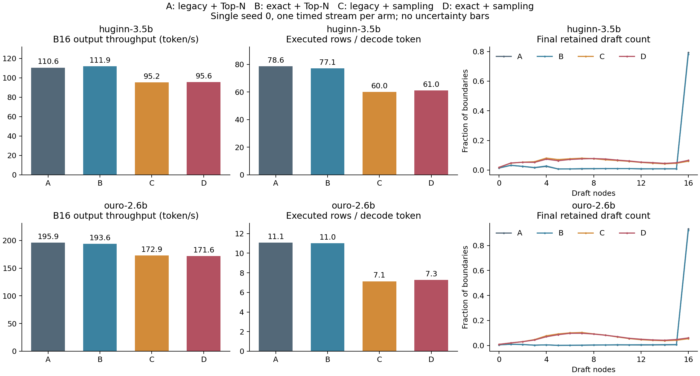

# LoopFill B16 树采样实验

单种子0、单次计时；2模型 × 4臂 × 480题，最多1024新token。c=1，N16，双读出Top-2，根Q4、孩子Q(4,4)，BF16 greedy，Graph-off，无行填充。

**结论：本轮两模型、两种评分下，树采样均未获得净加速。** 虽然计算行数减少，但γ下降、loop steps/token增加，且选择/采样引入额外开销。本轮证据不支持用该采样规则替换确定性Top-N；按计划未触发B1延迟补测。

| 模型 | 臂 | token/s | γ | rows/token | 平均保留草稿 | 输出token |
|---|---|---:|---:|---:|---:|---:|
| huginn-3.5b | A | 110.56 | 6.042 | 78.63 | 13.88 | 52124 |
| huginn-3.5b | B | 111.91 | 6.116 | 77.15 | 13.77 | 52744 |
| huginn-3.5b | C | 95.24 | 4.782 | 60.04 | 8.02 | 52832 |
| huginn-3.5b | D | 95.62 | 4.816 | 61.05 | 8.24 | 52759 |
| ouro-2.6b | A | 195.87 | 5.926 | 11.06 | 15.39 | 98753 |
| ouro-2.6b | B | 193.65 | 5.948 | 11.00 | 15.36 | 98909 |
| ouro-2.6b | C | 172.86 | 5.170 | 7.12 | 8.21 | 98560 |
| ouro-2.6b | D | 171.60 | 5.193 | 7.27 | 8.44 | 99455 |

| 模型 | 对比 | 吞吐变化 | rows/token变化 | 同输出请求 |
|---|---|---:|---:|---:|
| huginn-3.5b | B-A | +1.22% | -1.88% | 366/480 |
| huginn-3.5b | D-B | -14.55% | -20.87% | 385/480 |
| huginn-3.5b | C-A | -13.85% | -23.64% | 358/480 |
| huginn-3.5b | D-C | +0.40% | +1.67% | 376/480 |
| ouro-2.6b | B-A | -1.13% | -0.58% | 319/480 |
| ouro-2.6b | D-B | -11.38% | -33.91% | 310/480 |
| ouro-2.6b | C-A | -11.74% | -35.60% | 306/480 |
| ouro-2.6b | D-C | -0.73% | +2.04% | 305/480 |

A=旧评分+Top-N，B=补概率+Top-N，C=旧评分+采样，D=补概率+采样。

前置确定性Top-N保留；每个后续边界仅最终选择采样一次。完整计数、动态规模分布、停止原因见analysis.json；逐任务数据见task-metrics.csv。

限制：只有单次计时，不能推断跨运行或跨种子的稳定性；同输出子集仅作条件诊断。SpecBench参与过参数设计，不是独立held-out评测。BF16输出差异和任务质量需区分，当前不主张无损或质量改善。

## 代价分解与输出审计

| 模型 | 臂 | loop/token | readout rows/token | 选择CPU秒 | 其中采样秒 | suffix查询数 | 预算丢弃rows | 错路径丢弃rows | 已算节点重建 |
|---|---|---:|---:|---:|---:|---:|---:|---:|---:|
| huginn-3.5b | A | 5.296 | 11.193 | 10.91 | 0.00 | 277101 | 1010804 | 1327848 | 30548 |
| huginn-3.5b | B | 5.233 | 10.710 | 10.46 | 0.00 | 262939 | 940620 | 1348092 | 29054 |
| huginn-3.5b | C | 6.692 | 8.027 | 31.93 | 24.23 | 386191 | 706040 | 725656 | 34481 |
| huginn-3.5b | D | 6.645 | 8.183 | 32.21 | 24.48 | 377755 | 757308 | 725268 | 33715 |
| ouro-2.6b | A | 0.675 | 9.635 | 18.35 | 0.00 | 490618 | 248544 | 434228 | 50017 |
| ouro-2.6b | B | 0.672 | 9.505 | 18.02 | 0.00 | 477079 | 236809 | 440605 | 48095 |
| ouro-2.6b | C | 0.774 | 5.963 | 39.59 | 30.12 | 493752 | 110991 | 188226 | 40578 |
| ouro-2.6b | D | 0.770 | 6.072 | 40.37 | 30.70 | 495450 | 112641 | 203680 | 39494 |

选择时间包含采样；这些CPU函数计时仅用于开销归因，不替代同步端到端吞吐。推进行数是node-loop计数，不是FLOPs。

| 模型 | 采样臂 | 平均不同抽中节点 | 重复率 | 平均闭包大小 | 平均最终草稿 | 平均保留深度 | 超预算跳过 | 全零回退 |
|---|---|---:|---:|---:|---:|---:|---:|---:|
| huginn-3.5b | C | 6.40 | 59.3% | 8.25 | 8.06 | 4.22 | 9065 | 0 |
| huginn-3.5b | D | 6.52 | 58.6% | 8.49 | 8.28 | 4.21 | 9740 | 0 |
| ouro-2.6b | C | 6.73 | 57.6% | 8.39 | 8.25 | 3.88 | 6126 | 0 |
| ouro-2.6b | D | 6.85 | 56.8% | 8.64 | 8.48 | 3.89 | 7159 | 0 |

闭包大小指全部抽样结果的祖先并集，尚未应用预算限制；最终草稿数已应用预算跳过。事件平均包含空候选事件，重复率以实际抽取次数为分母；空候选计数见CSV。平均保留深度按最终边界中的节点出现次数加权。

| 模型 | 四臂共同输出请求 | A rows/token | B rows/token | C rows/token | D rows/token |
|---|---:|---:|---:|---:|---:|
| huginn-3.5b | 326/480 | 87.58 | 87.68 | 65.41 | 66.94 |
| ouro-2.6b | 256/480 | 8.79 | 8.76 | 6.04 | 6.15 |

共同输出子集属于事后条件诊断；当前请求输出相同不保证各臂此前的完成历史相同。逐请求首次分歧位置见output-audit.json。

| 模型 | 臂 | 平均未完成节点 | 平均执行行数 | 零分执行行数 | 停止token结束 | 达到长度上限 |
|---|---|---:|---:|---:|---:|---:|
| huginn-3.5b | A | 14.88 | 14.85 | 165096 | 472 | 8 |
| huginn-3.5b | B | 14.77 | 14.74 | 0 | 470 | 10 |
| huginn-3.5b | C | 9.02 | 8.97 | 0 | 471 | 9 |
| huginn-3.5b | D | 9.24 | 9.19 | 0 | 470 | 10 |
| ouro-2.6b | A | 16.39 | 16.39 | 58492 | 457 | 23 |
| ouro-2.6b | B | 16.36 | 16.36 | 0 | 457 | 23 |
| ouro-2.6b | C | 9.21 | 9.21 | 0 | 456 | 24 |
| ouro-2.6b | D | 9.44 | 9.44 | 0 | 457 | 23 |

未完成节点在每请求最终选择边界记录，包含根；执行行数按每请求推进tick记录。零分行数使用当前浮点路径分数，完整直方图见analysis.json。

